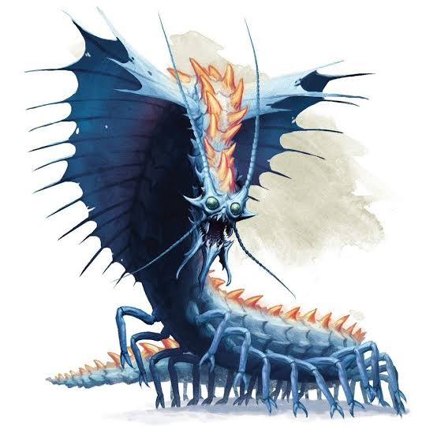
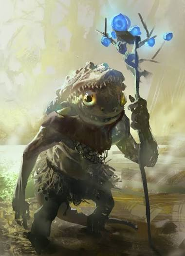
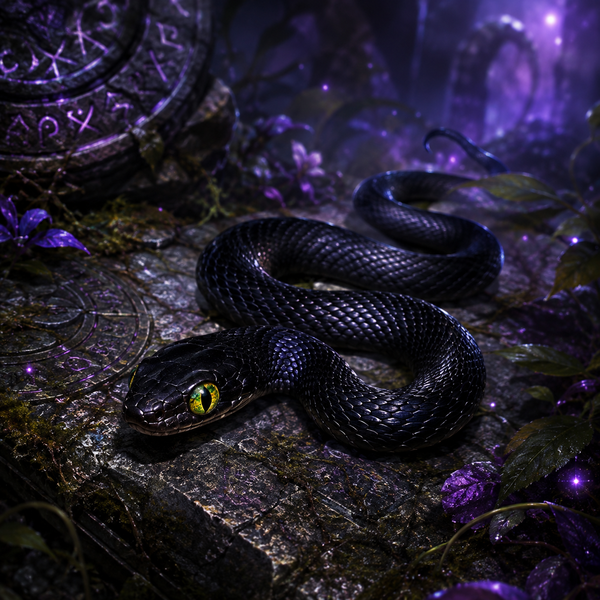

Questi tre riferimenti visivi compaiono nella scheda della sessione 3 del documento [Campagna](https://docs.google.com/document/d/1qBCdvsNVZTxvEwtIsxk8gWuU_yFiqPoD0dmWr4EbvHM). L’ordine segue il documento. Le immagini non ricevono identità aggiunte in base alla sola vicinanza a un paragrafo.

## Riferimento 1

## Riferimento 2

## Riferimento 3

→ [[Fonti/Galleria|Altri riferimenti visivi]]
