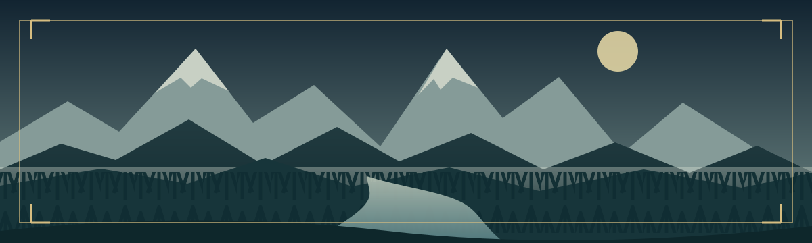

> *Dove finiscono le strade imperiali, cominciano la nebbia, il ferro e le storie ancora da raccontare.*

Vorsundeth è una provincia di frontiera dell'[[Istituzioni/Impero Infinito|Impero Infinito]]: una valle chiusa dalle montagne, attraversata da poche vie praticabili. Lungo le strade viaggiano minerali, carovane e soldati; oltre i presidi, foreste e paludi chiedono preparazione e guide fidate.

Questa è la **guida dei personaggi** al mondo di gioco. Le pagine raccolgono conoscenze generali sulla provincia, senza dare per scontato che ogni personaggio conosca ogni luogo di persona.

> [!tip] Da dove cominciare
> **Nuovi arrivati?** Leggete [[Provincia del Vorsundeth|La provincia in breve]] e [[Vorsundeth/Viaggiare nella provincia|Muoversi a Vorsundeth]].
> **Avete una destinazione?** Aprite l'[[Luoghi|atlante dei luoghi]].
> **Volete orientarvi tra le autorità?** Consultate [[Le istituzioni|poteri e istituzioni]].

## Tre direzioni, una provincia

| Verso                               |                                                                              |
| ----------------------------------- | ---------------------------------------------------------------------------- |
| ⛰️ [[Luoghi/Veldmark]]              | Il capoluogo nella montagna, le fonderie e il prezioso mithral.              |
| 🛡️ [[Luoghi/Il Bastione di Vetro]] | La città fortezza dove si incrociano strade, carovane e controlli imperiali. |
| 🌫️ [[Luoghi/Brumacava]]            | Passerelle e barche alle soglie della [[Luoghi/Palude Ghiacciata]]           |

## Esplora l'atlante

- **[[Provincia del Vorsundeth|La provincia]]** — territorio, stagioni, viaggi ed economia.
- **[[Luoghi|Luoghi]]** — città, insediamenti minerari e terre del nord.
- **[[Le istituzioni|Poteri e istituzioni]]** — governo ducale, presidio imperiale e Gilda delle Vene.

---

*L'atlante crescerà con la campagna. Cerca un nome nella barra di ricerca o segui i collegamenti tra le note.*

